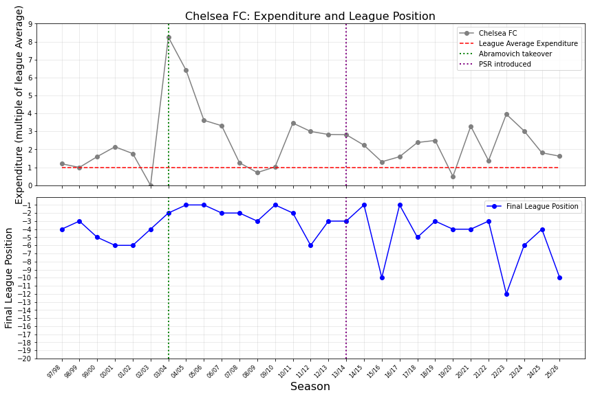
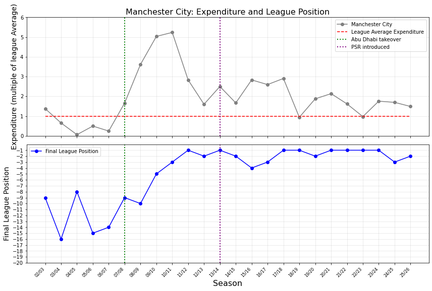
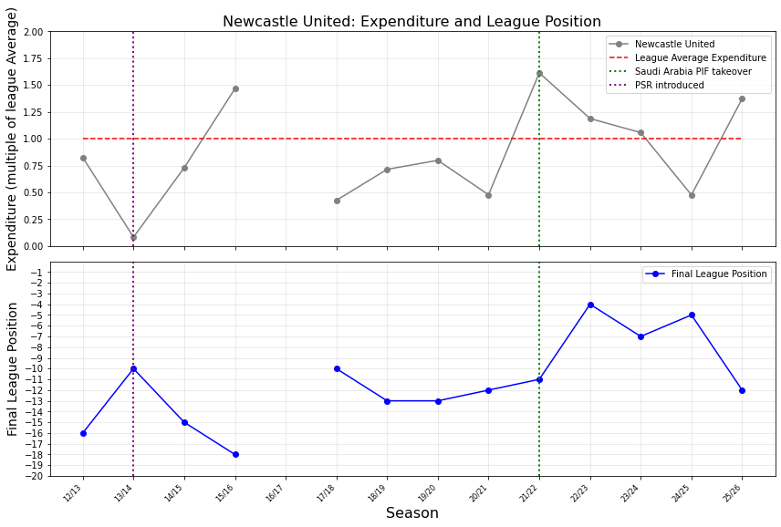
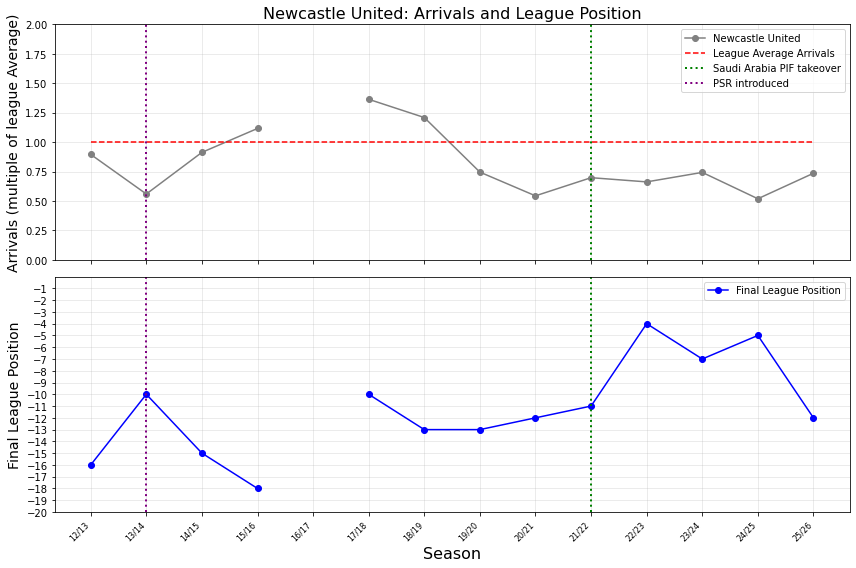
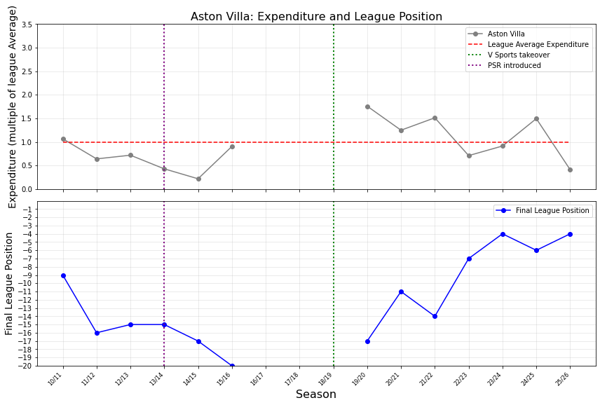
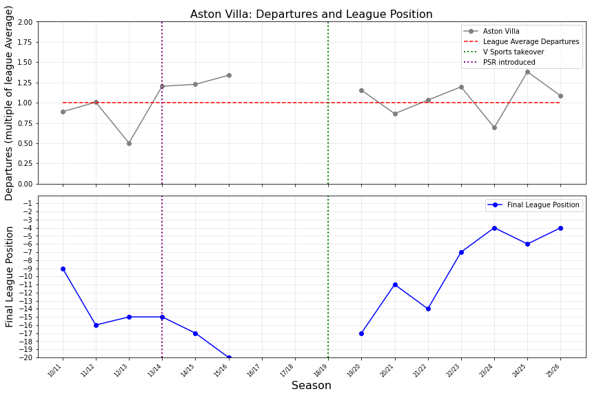

# How has PSR affected the transfer behaviour of clubs aspiring to compete at the top of the Premier League?
 
By Alex Sachar
 
# Project Background
 
Put simply, the Premier League's Profit and Sustainability Rules (PSR) exist to prevent two things:
 
1. **Owners unfairly injecting large sums of money into their clubs,** which can damage the integrity and competitive balance of the league. The most notable examples are Chelsea FC (bought by Russian oligarch Roman Abramovich in 2003) and Manchester City (bought by Sheikh Mansour's Abu Dhabi United Group in 2008).
2. **Clubs running up uncontrolled losses,** with the aim of protecting clubs from going out of existence due to poor ownership. Premier League clubs are permitted a maximum cumulative loss of £105 million over a rolling three-year period, of which owners may cover no more than £90 million.
It should be noted that most clubs operate at a loss: according to Deloitte's football finance data, 12 of the 20 Premier League clubs recorded a pre-tax or operating loss in the most recently analysed full financial season (2024/25).
 
Since its introduction in 2014, PSR has changed how clubs do transfer business. This project uses transfer and league-finish data scraped from TransferMarkt, covering every Premier League season since 1992/93, to examine how financial regulation has affected clubs that went through major ownership takeovers, and what that means for clubs trying to break into the established 'Big 6'.
 
Insights and recommendations are provided on the following key areas:
 
- **The Pre-Regulation Model:** How Manchester City and Chelsea, the league's most notable financially taken-over clubs, behaved in the transfer market before regulation, and how PSR changed that behaviour.
- **Newcastle United:** A post-regulation takeover focused on a single club, and the so-called 'doom spiral' that appears to have followed.
- **Aston Villa:** A post-regulation takeover built around a multi-club model and long-term infrastructure, taking a more nuanced approach to breaking the doom spiral.
- **Multi-Club Ownership (MCO):** How clubs outside the Big 6 are using MCO models to compete in a post-regulation world.

**Key terms:**
 
- **The 'Big 6'** refers to the league's largest, wealthiest and most prestigious clubs: Manchester United, Manchester City, Chelsea, Liverpool, Arsenal and Tottenham Hotspur.
- **Multi-Club Ownership (MCO)** refers to an ownership structure in which the owners of a Premier League club also acquire clubs in other, typically smaller, leagues, allowing them to pool resources, spread costs and ultimately work around PSR restrictions.
The Python script used to scrape and clean the TransferMarkt data can be found here: [TransferMarkt Data Plotting.py](TransferMarkt%20Data%20Plotting.py)

The accompanying HTML files for scraping can be found: [HTML for Python Script](HTML%20for%20Python%20Script)

The analysis figures for each club covered in this report can be found [here](Figures/).
 
 
 
# Data Structure & Initial Checks
 
The dataset was built by scraping TransferMarkt tables for every Premier League club from the 1992/93 season onwards. The total wealth of the Premier League has grown massively since its inception in 1992, driven by increasingly lucrative TV rights deals, and transfer fees have inflated alongside it. To account for this, each metric is expressed as a multiple of the league average for that metric in each season (the Python script also allows users to view the unweighted, raw trends). The key metrics used throughout the analysis are:
 
- **Expenditure:** Total transfer spend per club per season.
- **Income:** Total transfer income from player sales per club per season.
- **Arrivals / Departures:** The number of players signed (arrivals) and sold (departures) per club per season, i.e. transfer volume.
- **League Position:** Final league finish per club per season.

**Important Notes on the Figures** 
- When a club was not in the Premier League in a given season, there is no data on the 4 metrics. This is reflected in the figures as empty entries.
- Each figure shows the given metric over time in tandem with league position, to enable easier analysis on the relation between the two.
- Figures for Arrivals and Departure data have a Y-axis of upper bound 2, as clubs do never exceed 2x the League Average. For Expenditure and Income, different Y-axis bounds are given depending on the club, allowing the local trend to be analysed better. For example, using a bound of 9 for Chelsea shows the full comparison of their spending; using a bound of 9 for Newcastle would make seeing the trend in data harder.

# Executive Summary
 
### Overview of Findings
 
PSR's introduction in 2014 has shifted how Premier League clubs do transfer business, making it harder for clubs outside the 'Big 6' to compete for top league finishes. As a result, ambitious clubs are turning to Multi-Club Ownership (MCO) models to work within, and around, the financial restrictions. The key takeaways are:
 
- **PSR has limited big initial spending.** Newly taken-over clubs can no longer inject the huge sums that Chelsea's and Manchester City's owners did in their early years.
- **Clubs have been pushed into higher-volume transfer business,** typically involving youth players, who can be sold for pure accounting profit under PSR rules.
- **Clubs are being forced to sell their best players to stay within PSR.** This weakens the squad and damages the club's appeal, creating a 'doom cycle' in which league performance drops, which in turn motivates more players to leave.
- **Clubs are using different strategies to break the cycle,** most notably MCO models and a stronger focus on recruitment.
# Insights Deep Dive
 
### Case 1: Chelsea and Manchester City
 
* **Huge early spending, then a pullback.** Chelsea spent between 4x and 8x the league average in the first few seasons after takeover, before reducing spending to around 2x–3x the league average; City followed a similar pattern. Chelsea's reduced spending from 2005/06 to 2009/10 had little effect on league performance, likely because the club's footballing structures and business infrastructure had already been invested in and established.
* **Income rises a few seasons after takeover.** Both Chelsea and City saw income increase several seasons after their takeovers, likely from selling players bought during the initial spending years.
* **PSR changed Chelsea's transfer behaviour.** Chelsea's expenditure generally fell after PSR was introduced, while income rose notably, likely due to pressure to sell players to stay within the regulations, as supported by a rise in departures over the same period. Since 2012, Chelsea's arrivals have also increased sharply, likely to replace the players sold. Their league position fell during these years, possibly as tighter financial restrictions forced the club to change how it stayed competitive.
* **City's spending dipped, but performance didn't.** City's expenditure also dipped and departures increased after PSR, yet their league performance did not decline. This was down to a combination of factors: recently uncovered financial breaches involving 'disguised funding', a diverse MCO business strategy, little pressure to sell their best players to comply with PSR, and the appointment of Pep Guardiola as first-team manager during this period.
* **The head start mattered.** Chelsea and Manchester City both used their head start on PSR to achieve instant and sustained success. This made them attractive destinations for players, making it easier to sign and keep top players even after PSR was introduced.
#### Figures for Chelsea:
 

 
**More Chelsea figures:** [Income](Figures/chelsea_income.png) · [Arrivals](Figures/chelsea_arrivals.png) · [Departures](Figures/chelsea_departures.png)
 
#### Figures for Manchester City:
 

 
**More Manchester City figures:** [Income](Figures/man_city_income.png) · [Arrivals](Figures/man_city_arrivals.png) · [Departures](Figures/man_city_departures.png)
 
 
### Case 2: Newcastle United
 
* **A much smaller initial spend.** Following their high-profile takeover by Saudi Arabia's Public Investment Fund (PIF) in 2021, Newcastle only increased expenditure to around 1.6x the league average, and expenditure has fallen more or less every season since, dropping below the league average. This is markedly different from the pattern shown by Chelsea and Manchester City.
* **Low transfer volume.** Newcastle's arrivals and departures have been below the league average every year since takeover, pointing to difficulty doing transfer business, possibly because of PSR.
* **Same income pattern, different reason.** Newcastle's income flatlined at first and then increased each season, the same pattern as City and Chelsea but on a smaller scale. For Newcastle, however, this was likely driven by PSR pressure to sell, rather than cashing in on matured player investments.
* **An instant uptick in league position.** Like City and Chelsea, Newcastle's league position improved immediately after takeover, helped by the appointment of Eddie Howe as manager, greater investment and attention from the owners across the club's structures, and a general optimism surrounding the club.
* **The doom spiral.** Newcastle have been forced to sell star players from this period of improved performance. Selling is an easy way to stay within PSR's loss threshold, but it creates a negative cycle: the club struggles to buy and keep top players, so current and prospective players come to believe trophies can't be won there and would rather join a Big 6 club. Newcastle are forced to sell to rivals, so their squad gets weaker while rivals get stronger, league performance drops, and the owners may lose confidence in the project. Each factor then feeds the next. The higher quality of today's Premier League compared with 20 years ago makes sustaining success even harder.
* **PSR has made the Big 6 a closed shop.** Newcastle's lack of appeal to star players is partly down to being seen as a 'second-rate' destination, outside the profile and prestige that come with playing for a Big 6 club. City and Chelsea once carried this reputation too, but with no financial regulation in place they could brute-force success and shake it off. Newcastle have neither the status nor the financial freedom to do the same.
* **Recruitment is the new circuit breaker.** The circuit breaker to the doom spiral used to be money; now it is recruitment. The fee from selling Alexander Isak, Newcastle's best player, to league rivals Liverpool in 2025 was reinvested in underwhelming signings such as Nick Woltemade and Anthony Elanga. Smarter, performance-analysis-led recruitment may have softened the loss of Isak and helped sustain the club's league performance. By contrast, Brighton & Hove Albion have sustained success despite consistently selling their best players, by investing in relatively unknown players found through a wide scouting network. This has delivered a better return on investment and kept them out of the doom spiral. However, Brighton's aim does not appear to be breaking into the Big 6, but rather sustained top-half finishes while strengthening the club's infrastructure and footballing structures.
* **No multi-club model (yet).** Newcastle have focused on a single club rather than an MCO model, although a [Daily Mail report](https://www.dailymail.com/sport/football/article-15553515/Newcastle-players-summit-Saudi-multi-club-network-Bruno-Guimaraes-injury.html) from February 2026 suggests PIF are now looking into adopting one.

 

 
**More Newcastle figures:** [Income](Figures/newcastle_income.png) · [Departures](Figures/newcastle_departures.png)
 
 
### Case 3: Aston Villa
 
* **A multi-club takeover.** Villa were bought by V Sports in 2018 and adopted a multi-club ownership model, acquiring strategic and controlling stakes in Vitória SC (Portugal), Real Unión (Spain) and FC Annecy (France).
* **Steady improvement on the pitch.** Since returning to the Premier League in 2019, Villa's league position has risen steadily. This is likely helped by greater attention and investment from the owners, but mainly by the impact of manager Unai Emery, widely regarded as one of the best in the league.
* **Falling spend, volatile income.** Expenditure has steadily decreased since takeover, regularly dipping below the league average. Income has fluctuated heavily, as have arrivals and departures, likely due to being forced to sell players to comply with PSR. This suggests difficulty in translating owner wealth into on-pitch investment.
* **Investing in long-term stability.** Villa have invested in the club's future through a new stand at Villa Park, a training centre, the MCO model and the women's team.
* **Not immune to the doom spiral.** Villa have faced the same problems as Newcastle. Without a strong recruitment strategy, and following underwhelming signings this year, they are seeing their first dip in league form under Emery. In summer 2026 alone, despite qualifying for the Champions League (which top players generally see as essential to a club's appeal), Villa were forced to sell star players including Morgan Rogers, Emi Martínez, Youri Tielemans and Ollie Watkins. Villa have argued publicly that PSR has calcified the Big 6, as the doom spiral is hard to escape without external investment.

 

 
**More Aston Villa figures:** [Income](Figures/aston_villa_income.png) · [Arrivals](Figures/aston_villa_arrivals.png)
 
 
### Category 4: Multi-Club Ownership (MCO)
 
* **Cheaper talent pipelines.** An MCO model lets clubs scout, sign and develop young talent in lower-cost leagues. When ready, players either move to the flagship Premier League club or are sold externally for pure accounting profit, which helps the group stay within PSR.
* **Shared costs.** PSR limits how much of a club's losses its owners can cover. Under MCO, costs such as data analytics and scouting can be spread across the whole group, so the owner's money goes further at the main club.
* **More room for homegrown players.** PSR usually pressures the main club to sell its youth players for pure profit. With MCO, youth players from across the group can be sold instead, giving the main club's homegrown players a better chance of staying in the side.
* **Internal transfers to balance the books.** Players can be sold between clubs in the same group at seemingly unfair market values to keep accounts balanced.
* **Higher transfer volume.** Overall, PSR has driven transfer volume up, as clubs face pressure to sell youth players for pure profit. As outlined above, MCOs help ease this pressure by enlarging the pool of players available to sell.
# Recommendations:
 
Based on the insights and findings above, clubs outside the Big 6 seeking to compete should consider the following:
 
* PSR prevents the large, sustained spending that built Chelsea and City, and recruitment is now the circuit breaker to the doom spiral. **Make recruitment the core of the strategy, prioritising smart, value-driven signings over big-money spending.**
* MCO models allow costs to be shared across a group and talent to be developed cheaply in lower-cost leagues. **Consider adopting a multi-club ownership model to make spending go further at the main club.**
* Selling a star player every year weakens the squad, damages the club's appeal and feeds the doom spiral. **Use youth and MCO player sales to meet PSR where possible, to avoid selling the best players.**
* Villa's investment in a new stand, training centre and women's team has helped builed stability beyond the first team. Similarly, Chelsea's relative pullback in spending in the late 00's had little effect on league performance due to strong, new business and footballing structures now being in place. **Invest in infrastructure and club structures that support success independently of transfer spend.**
* A club's reputation affects its ability to attract and keep top players, and PSR makes it hard to buy a new one. **Build the club's appeal through steady progress on the pitch and visible long-term commitment from owners.**
# Assumptions and Caveats:
 
Throughout the analysis, multiple assumptions were made to manage challenges with the data. These assumptions and caveats are noted below:
 
* All transfer and league data is sourced from TransferMarkt.com, so expenditure and income reflect TransferMarkt's reported transfer fees rather than clubs' official accounts.
* Many of the explanations for trends (e.g. selling players to comply with PSR) are inferred from the data and wider context, and show correlation rather than proven causation.
* Factors outside the transfer data, such as managers, owner attention and financial breaches, also affect league performance and are discussed qualitatively rather than measured.
 
